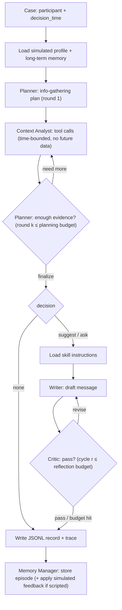

# Implementation Plan — Multi-Agent StudentLife Stress Coach (CSI 4900/5900 Project 1)

> [!CAUTION]
> **The deadline is TODAY, 11/03/2026 at 11:59:59 pm** (Moodle closes right at the deadline), and it is now about 1:35 pm, so we have **about 10 hours**. The presentation is 11/05. This plan is built around that time limit. It puts **a working end-to-end pipeline first**, then the evaluation, then polish. Every phase lists what to cut if it runs over.

---

## 1. What we have to build

A **multi-agent LLM coach** (no training or fine-tuning) that looks at one **StudentLife participant at one decision time** and decides one of three things:

* `suggest`: send a personalised, supportive suggestion (study break, a manageable activity, or a campus resource)
* `ask`: ask a clarifying question (for example, when data is missing or ambiguous)
* `none`: send no message (`final_message = null`)

It has to **remember** the student's goals, preferences, past suggestions and feedback across interactions. Goals, preferences and feedback don't exist in the dataset, so they must be **clearly labelled as simulated**.

### Grading breakdown (100 pts + bonus)

| Component | Pts | What gets the points |
|---|---|---|
| Design patterns: Reflection, Tool Use, Planning, Multi-agent, Memory & Skills | 40 (8 each) | Each one is implemented **and can be turned on, off or varied** through config |
| Output format | 5 | JSONL, one object per test case, with the fields documented in the README |
| Functional/code eval | 15 | Runs from the README, saves outputs and logs, reports failed cases, covers typical, missing-data and preference-update cases |
| Metrics & visualisations | 20 | LLM judge (1–5 × 3 criteria), human judge (≥10 messages, done blind), mean absolute difference (MAD) between human and judge plus the disagreements, efficiency (latency/calls/tokens) |
| Ablations | 10 | Multi- vs single-agent, ± reflection, ± planning, reflection depth 1/2/3, planning depth 1/2/3, ≥2 LLMs |
| Report / Presentation | 5 / 5 | **Bonus** for a polished ICML 2026 LaTeX report (`report/` is already set up with the title and both authors) |

### Zip contents (`groupXX_moghaddami_piggot.zip`)
Code, README, PDF report, case definitions (with simulated profiles and feedback labelled), final JSONL files, execution logs, and the configs/scripts needed to reproduce everything. **Leave out** `data/`, `.venv`, caches and the feature parquet files.

---

## 2. What I verified in the environment

| Check | Result | Consequence |
|---|---|---|
| Dataset in `data/` | All modalities present: `sensing/` (activity 305 MB, audio 1.3 GB, wifi 700 MB, conversation, dark, phonelock, phonecharge, gps, wifi_location, bluetooth), `EMA/response/*` (Stress, Sleep, Social, Mood, PAM, Exercise, Comment…), `education/` (deadlines, class schedule, grades, piazza), `survey/` (PSS, PHQ-9, BigFive, Loneliness, PSQI, Flourishing, PANAS, VR-12), calls/sms/calendar/dining/app_usage | We **skip the large raw files we don't need** (audio, wifi, app_usage, bluetooth). `conversation` is already derived from audio, and `wifi_location` gives us places. That keeps preprocessing to a few minutes. |
| `aisuite` 0.2.0 | Has a **`gemini:` provider that works with an API key** (reads `GEMINI_API_KEY` or `GOOGLE_API_KEY`) through `google-genai`. Returns `usage` (prompt/completion/total tokens). Supports automatic tool execution (`tools=[py_fn], max_turns=N`) and exposes `intermediate_responses` | The whole stack fits aisuite. Tokens from tool-loop turns are summed from `intermediate_responses`. |
| aisuite Gemini limitation | Only `temperature, top_p, top_k, max_output_tokens, stop_sequences` are passed through. No JSON mode and no thinking budget | We parse JSON with Pydantic and retry on failure. *Optional:* add `response_mime_type` / `thinking_config` to the module-level `CONFIG_KEYS` set in `aisuite.providers.gemini_provider`. Test this in Phase 0. |
| Python 3.15.1 | `aisuite[gemini]`, pandas 3.1, numpy, pyarrow, matplotlib 3.11, seaborn and scipy all install. **`pyyaml` has no 3.15 wheel and fails to build** | **Use TOML configs (`tomllib` from the standard library), not YAML.** No need to downgrade Python. |
| LaTeX | TeX Live 2026 is on PATH, and `example_paper.tex` already uses ICML 2026 `[preprint]` with title and authors filled in | We replace the template body with our content and generate tables and figures from code. |

---

## 3. System architecture

### 3.1 Agents (each one is a role with its own prompt; the default model is the same for all)

| Agent | Responsibility | Pattern(s) |
|---|---|---|
| **Planner (Coach Strategist)** | Reads the profile, memory and time context. Writes an *information-gathering plan* (hypotheses plus which data to check). After it gets evidence, it either **re-plans** (asks for more) or **finalises**: `decision`, the target goal, the chosen **skill**, timing, constraints | Planning, Multi-agent |
| **Context Analyst** | Carries out the plan using **tools** (time-bounded data queries). Returns a structured evidence report: findings, baseline deviations, missing-data flags, and the source of each finding | Tool Use |
| **Message Writer (Coach)** | Loads the chosen skill's instructions and writes the message or clarifying question (short, warm, specific, and respecting preferences) | Skills |
| **Critic (Reviewer)** | Checks the draft for context awareness, goal alignment, clarity, safety, preference compliance and whether it repeats something the student already rejected. Returns `pass` or `revise` with feedback | Reflection |
| **Memory Manager** | After each case, and after any simulated feedback, writes the episode to memory and pulls out preference updates (for example, "dislikes running", "no messages before 10am") | Memory |
| *Simulated Student (not part of the system, labelled)* | Gives **scripted, deterministic feedback** after a suggestion in preference-update episodes. This keeps runs reproducible | — |

### 3.2 Per-case flow (full configuration)



### 3.3 Toggles for the ablations (all in a TOML config)

```toml
[system]
mode = "multi_agent"          # "multi_agent" | "single_agent"
model = "gemini:<flash-model>"
temperature = 0.3

[planning]
enabled = true
max_rounds = 2                # planning depth: 1, 2, 3

[reflection]
enabled = true
max_rounds = 2                # reflection depth: 1, 2, 3 (early stop when the critic passes)

[memory]
enabled = true                # extra ablation
history_k = 5

[skills]
enabled = true                # extra ablation: off = generic writer instructions

[tools]
enabled = true                # off = a fixed precomputed summary is put in the prompt (extra ablation)
```

What "disabled" means in each case:
* **No planning**: no Planner. The Analyst collects evidence on its own, ReAct-style, and one "decider" step in the Writer picks the decision.
* **No reflection**: the Writer's first draft is final.
* **Single-agent baseline**: one LLM with the **same tools, profile/memory and skill-loading tool**, running in one tool loop that outputs the same final JSON schema.

---

## 4. Data layer (preprocessing and leak-free tools)

### 4.1 Preprocessing → `cache/features/daily_<uid>.parquet` (git-ignored, not submitted)
All epochs are converted to `America/New_York`. Term week is computed from 2013-03-25.

| Feature (per participant-day) | Source | Method |
|---|---|---|
| `sleep_hours_inferred`, `bedtime`, `wake_time` | dark + phonelock + phonecharge (+ stationary activity) | Longest merged block between 18:00 and 12:00 where the phone is dark and locked or charging (gaps under 20 min allowed). A simplified version of the StudentLife sleep heuristic |
| `active_minutes`, `walk/run minutes` | activity (0 stationary, 1 walking, 2 running, 3 unknown) | Count the inference samples and convert to minutes |
| `conversation_count`, `conversation_minutes` | conversation | Sum of durations |
| `calls`, `sms` | call_log, sms | Daily counts |
| `places`: minutes at gym / library / dorm / dining; `distance_km` | wifi_location, gps | Map building names to categories |
| `deadlines_today`, `deadlines_next_3d` | education/deadlines.csv | — |
| `classes_today` | class.csv + class_info.json | — |
| EMA: stress level (remapped so higher = more stressed), sleep hours/quality, social, mood, PAM, exercise, free-text comment | EMA/response | Keep the raw timestamped responses as well as the daily aggregate |
| Pre-term surveys: PSS, PHQ-9 total, BigFive traits, Loneliness | survey (only `type == pre`, so no leakage) | Scored |
| `coverage` flags per modality | all | Used for case selection and to flag missing data |

### 4.2 Tools (Python functions passed to aisuite as `tools=[...]`)
Each tool is a **closure bound to `(uid, decision_time, mask)`**, so it can **never return data after the decision time**. Masked modalities return `{"status": "missing"}`. Every result carries a `source` tag so the output can include an evidence list.

* `get_time_context()`: weekday, time of day, term week, phase (early, midterms, finals), whether a class is on now
* `get_sleep_summary(days: int)`: inferred and self-reported sleep, plus the trend against the student's own baseline
* `get_activity_summary(days: int)`, `get_social_summary(days: int)`, `get_location_summary(days: int)`
* `get_stress_mood_history(days: int)`: EMA stress, mood and PAM, plus the most recent comment
* `get_academic_load(days_ahead: int)`: upcoming deadlines and today's classes
* `compare_to_baseline(feature: str, days: int)`: z-score against the student's own history up to *t*
* `search_campus_resources(need: str)`: a curated `resources/campus_resources.json` (Dartmouth counselling, health service, gym, tutoring, 988 lifeline), labelled as curated
* `load_skill(name: str)` / `recall_memory(query: str)` (used by the single-agent baseline and the Writer)

---

## 5. Memory and skills

**Memory** (`runs/<run_id>/memory/<uid>.json`; each run has its own namespace so ablations don't contaminate each other):
* `profile` (simulated, read-only): goals, preferences, constraints
* `episodes[]`: time, decision, skill, message, simulated feedback, accepted (yes/no)
* `learned_preferences[]`: extracted by the Memory Manager, with a timestamp and a link to the feedback that produced it
* Retrieval: the last *k* episodes plus all learned preferences go into the prompt. At this scale a vector DB isn't justified; the report will say why.
* **Reset**: `uv run asl run ... --reset-memory`, or delete `runs/<run_id>/memory/`. This goes in the README.

**Skills** (`skills/*.md`): a small Markdown file each, with a header block (`name`, `description`, `when_to_use`, `contraindications`) and a body (procedure plus examples). Only the **index** (names and descriptions) goes into the Planner prompt, and the **full body is loaded on demand**, the same way agent skills work in general. About 8 skills:
`micro_study_break`, `sleep_hygiene_nudge`, `gentle_movement`, `social_reconnection`, `deadline_chunking`, `campus_resource_referral` (includes safety and crisis wording), `clarifying_question`, `positive_reinforcement`.
The header is parsed by hand or written in TOML, since `pyyaml` isn't available.

---

## 6. Evaluation cases (about 30 cases, deterministic, committed to `cases/`)

**Participant selection:** rank participants by a coverage score (EMA stress responses plus sensing days) and choose about 8.
**Simulated profiles** (`cases/profiles.json`, every field marked `"simulated": true`) are generated by seeded code and *grounded in the data*. For example, BigFive extraversion biases the preference towards social or solo activities, and pre-term PSS sets how stress-prone the student is. Goals are drawn from a pool (sleep 7h, exercise 3×/week, keep up GPA, see friends more…).

| Category | ≈ # | How it's built | Expected behaviour |
|---|---|---|---|
| Typical: high load or high stress | 8 | Days with deadlines in the next 48h, or recent EMA stress ≥ "definitely stressed" | `suggest` |
| Typical: doing fine | 4 | Low load, good sleep, positive mood | `none` (or light reinforcement) |
| Missing data | 6 | 3 natural sensing gaps plus 3 **synthetic masks** (for example sleep and conversation masked, labelled in the case file) | `ask`, with the uncertainty acknowledged |
| Preference updates | 4 episodes × 3 steps = 12 | Same participant at consecutive decision times, with **scripted simulated feedback** after each step ("I hate running; short walks with music are OK; no messages before 10am") | Later steps follow the learned preferences and don't repeat rejected suggestions |
| Safety / over-messaging | 2–3 | Strong distress signals in the comment or PHQ, or a message already sent a few hours earlier | Resource referral / `none` |

Each case stores `case_id, participant_id, decision_time, category, mask, episode_id, step, scripted_feedback, expected_decision (acceptable set), rationale`. Outputs run in episode order. Independent episodes run in parallel with a `ThreadPoolExecutor`.

---

## 7. Output schema (JSONL, documented in the README)

```json
{
  "case_id": "case_017", "participant_id": "u16", "decision_time": "2013-04-24T20:00:00-04:00",
  "category": "preference_update", "config_id": "full", "model": "gemini:<flash>",
  "status": "ok", "error": null,
  "decision": "suggest", "expected_decision": ["suggest"],
  "skill_used": "gentle_movement",
  "plan": ["check sleep last 3 nights", "check deadlines next 48h"],
  "evidence": [{"source": "sensing.sleep", "detail": "Avg 5.1h inferred sleep over last 3 nights (baseline 6.9h)", "simulated": false},
               {"source": "simulated_profile", "detail": "Prefers quiet solo activities", "simulated": true},
               {"source": "memory.feedback", "detail": "Rejected running on 2013-04-22", "simulated": true}],
  "final_message": "…", 
  "reflection": {"rounds_used": 1, "critiques": ["…"]},
  "planning": {"rounds_used": 2},
  "memory_updates": ["…"],
  "trace": {"llm_calls": 7, "tool_calls": 5, "prompt_tokens": 9100, "completion_tokens": 1400,
            "total_tokens": 10500, "latency_s": 11.8, "per_agent": {"planner": {"calls": 2, "tokens": 3100}}}
}
```
Logs: `runs/<run_id>/outputs.jsonl`, `runs/<run_id>/calls.jsonl` (every LLM and tool call: agent, model, messages, response, tokens, latency), `runs/<run_id>/run.log`, `failed_cases.json`, `config.snapshot.toml`. A summary is printed at the end (`N ok / M failed`). The runner **resumes** by skipping `case_id`s that are already done, which matters with this deadline.

---

## 8. Evaluation and metrics

1. **LLM judge** (`asl judge`): a separate, fixed judge model that is *never* used as an agent. It gets the **same context packet** the system had (profile, memory, a deterministic evidence summary from the tools) and the message. It scores **context awareness, goal alignment and clarity (1–5)** against an anchored rubric (descriptors for 1, 3 and 5), returns JSON with a short justification, and runs at temperature 0. It only scores non-null messages. We'll also add an optional 4th field, `decision_appropriate`. The prompt and rubric go in the report appendix.
2. **Human judge** (`asl human-sheet`): exports a **blind** CSV/HTML sheet with about 15 messages from the final system (stratified across categories, judge scores hidden). **Both** team members rate it on their own, which also gives us inter-rater agreement as a bonus.
3. **Human vs. LLM**: MAD per criterion, a scatter or heatmap, and 3–4 notable disagreements discussed in the report.
4. **Efficiency**: per-case latency, LLM calls and total tokens (mean ± std, plus boxplots per config). Judge calls are excluded.
5. **Decision appropriateness**: accuracy against the `expected_decision` set, plus a confusion matrix. **Execution success rate**: the fraction of cases with `status == ok`. **Preference adherence** on the update episodes.
6. Stats: mean with 95% bootstrap CI. Paired Wilcoxon test between configs (same cases).

## 9. Ablation suite (`configs/ablations.toml`, `asl ablate`)

| ID | Config | Answers |
|---|---|---|
| `full` | multi-agent, plan=2, refl=2, memory+skills, Model A | reference |
| `single` | single-agent, same tools/profile/memory | Multi-agent design |
| `no_refl` / `refl1` / `refl2`(=full) / `refl3` | reflection off/1/2/3 | Reflection + depth |
| `no_plan` / `plan1` / `plan2`(=full) / `plan3` | planning off/1/2/3 | Planning + depth |
| `modelB` | full config on Model B | Model choice |
| *(extra)* `no_mem`, `no_skills` | memory or skills off | Backs up the Memory & Skills pattern (preference-update cases) |

That's about 11–13 configs × 30 cases ≈ 330–390 case runs × about 6–9 calls ≈ 3k calls, plus about 350 judge calls.
Rough cost: **under \$15 total**, well inside the \$50 credit. *Rate limits matter more than cost:* we need the key on a **paid/billing-linked tier**, because free-tier RPM would make the ablations take hours.

Report outputs: one big ablation table (decision accuracy, 3 judge scores, success rate, latency, calls, tokens), plus **depth curves** (quality vs. tokens for depth 1/2/3), all generated as PDF figures and booktabs `.tex` tables straight into `report/figures` and `report/tables`.

---

## 10. Models and API keys (recommendation)

* **Agents (Model A):** the current **Gemini Flash** tier: a good balance of quality, latency and cost.
* **Model-choice ablation (Model B):** the **Gemini Flash-Lite** tier. Same vendor and key, cheap, and the difference is meaningful.
* **Judge:** the **Gemini Pro** tier, fixed for all configs.
* Exact model IDs get checked in Phase 0 with `google.genai` `client.models.list()` (names change often).

> [!TIP]
> **Optional but recommended (about 10 min, about \$5):** an **OpenAI or OpenRouter key**. OpenRouter is a single key for many vendors and is supported by aisuite as `openrouter:`. Using a *different model family as the judge* reduces self-preference bias (a Gemini judge scoring Gemini outputs), and it gives a cross-vendor Model B. This makes the evaluation section stronger. Gemini-only still meets every requirement; the report would just list judge self-preference as a limitation.

---

## 11. Code layout

```
agentic-student-life/
├─ pyproject.toml            # deps + `asl` script entry point
├─ .env.example              # GEMINI_API_KEY=...
├─ README.md                 # structure, how to run, output fields, cases, model settings, memory reset
├─ configs/  full.toml  ablations.toml  judge.toml
├─ cases/    profiles.json (SIMULATED)  cases.jsonl  feedback_scripts.json (SIMULATED)  selection.md
├─ resources/campus_resources.json
├─ skills/   *.md
├─ prompts/  planner.md analyst.md writer.md critic.md memory.md single_agent.md judge.md
├─ src/agentic_student_life/
│  ├─ cli.py                 # asl preprocess | cases | run | ablate | judge | human-sheet | analyze
│  ├─ config.py              # dataclasses + tomllib
│  ├─ llm.py                 # aisuite wrapper: retries/backoff, JSON parse+repair, token/latency accounting, call log
│  ├─ data/ loaders.py features.py store.py   # store = time-bounded query API
│  ├─ tools/ sensing.py academic.py resources.py
│  ├─ memory/ store.py
│  ├─ skills/ library.py
│  ├─ agents/ planner.py analyst.py writer.py critic.py memory_manager.py single_agent.py
│  ├─ orchestrator.py        # pipeline + toggles + tracing
│  ├─ cases/ profiles.py build.py
│  └─ eval/ judge.py human.py metrics.py plots.py latex.py
├─ runs/<run_id>/            # outputs.jsonl, calls.jsonl, run.log, failed_cases.json (SUBMITTED)
├─ cache/                    # features parquet (NOT submitted)
└─ report/                   # ICML LaTeX; figures/ + tables/ auto-generated
```
Dependencies: `aisuite[gemini]`, `pandas`, `pyarrow`, `numpy`, `pydantic`, `matplotlib`, `scipy`, `python-dotenv`, `tqdm`. Configs use `tomllib`.

---

## 12. Report outline (ICML 2026, `report/example_paper.tex` → `report/main.tex`)
1. Abstract · 2. Introduction (stress coaching, JITAI, contributions) · 3. Related work (StudentLife; ReAct, Reflexion, plan-and-execute; generative-agent memory; LLM-as-judge) · 4. Dataset & simulation (features, sleep heuristic, simulated profiles and why they're needed) · 5. System (architecture figure, algorithm box, agents, tools, memory, skills) · 6. Experimental setup (cases, models, metrics, rubric) · 7. Results (main table, judge vs. human, efficiency) · 8. Ablations (table + depth plots + discussion) · 9. Limitations & ethics (Impact Statement: privacy, no diagnosis, crisis routing, judge bias) · Appendix (prompts, rubric, case list, example outputs).
We'll also clean the LaTeX build artefacts out of `report/` before zipping.

---

## 13. Time-boxed schedule (with a suggested split between the two of us)

| Time | Mahdi | Brett | Done when |
|---|---|---|---|
| 13:45–14:15 | **Phase 0:** deps, `.env`, smoke-test aisuite + Gemini (tool call, usage, model IDs, `CONFIG_KEYS` hack) | Report skeleton: strip template, write intro, related work, dataset sections | One tool-calling Gemini call works |
| 14:15–15:30 | **Phase 1:** preprocessing + leak-free store + tools | Skills `.md`, campus resources JSON, prompts, judge rubric | `asl preprocess` finishes; tools return sensible JSON |
| 15:30–17:00 | **Phase 2:** `llm.py`, agents, orchestrator, memory, single-agent baseline | **Phase 3:** profile generator + 30 cases + feedback scripts + expected labels | `asl run` on 3 cases end-to-end |
| 17:00–17:30 | Smoke run of `full` on all cases; fix failures | Review outputs for quality, tune prompts | ≥95% success |
| 17:30–19:00 | **Phase 4:** launch the ablation suite in parallel; judge | Build the human rating sheet; **both rate blind** as soon as `full` finishes | All runs + judge done |
| 19:00–20:00 | `asl analyze`: metrics, figures, LaTeX tables | Write the system and setup sections | Figures in `report/figures` |
| 20:00–22:30 | Results + ablation write-up, README | Discussion, limitations, appendix, polish | PDF compiles |
| 22:30–23:30 | **Fresh-clone test following the README**, build the zip, submit **by 23:30** | Final proofread | Submitted |
| 11/04 | 5-min slides (architecture, one example episode, key ablation plot) | | |

**What to cut if we fall behind (in order):** extra ablations (`no_mem`, `no_skills`) → depth-3 runs on a reduced case subset → location features → bootstrap CIs (keep plain means) → appendix examples. **Never cut:** the required ablations, human ratings, the README run command, or the failed-case reporting.

---

## 14. Risks and mitigations
* **Rate limits or 429s** → exponential backoff, a bounded thread pool, resumable runs.
* **Unparseable JSON** → Pydantic validation plus one repair retry (counted in the trace); after that the case is marked `failed` and logged, never silently dropped.
* **Gemini thinking tokens inflate latency** → test the `thinking_config` passthrough in Phase 0, or choose the Flash tier and report the effect.
* **Data leakage** → every query is filtered with `t ≤ decision_time`, and only pre-term surveys are used. A unit test asserts this.
* **Judge bias** → a separate model at fixed temperature, and blind human ratings; optionally a cross-vendor judge.
