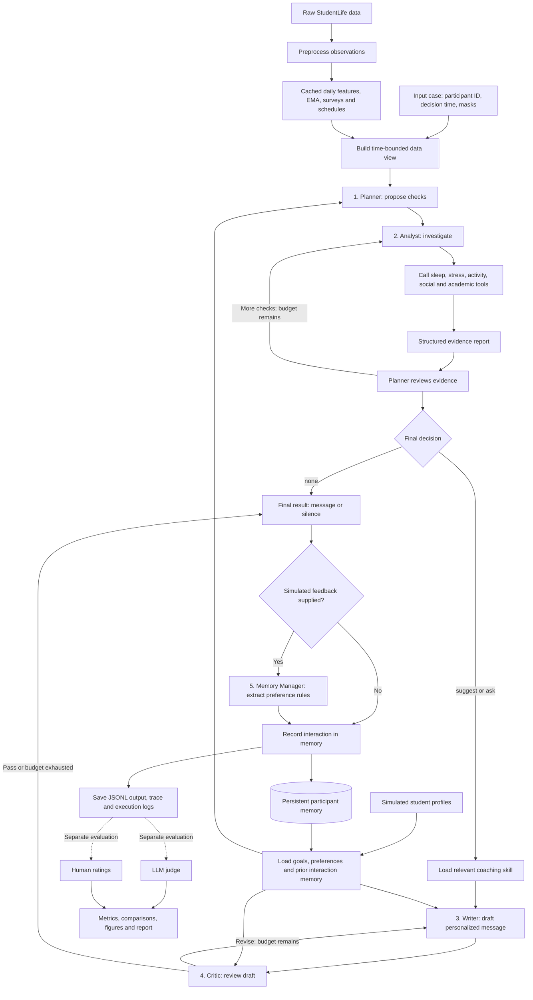

# Useful Presentation Info

## Simulated Profiles

"The coach should remember and use the student’s goals, preferences, previous suggestions, and feedback across interactions. Use clearly labeled simulated profiles and interactions for information not available in the dataset."

"The StudentLife dataset does not include students’ personal goals or coaching preferences. You may create these profiles manually or generate them randomly using code, based on your system design."

Yes. **The requirement calls for a student-specific profile and memory that evolves across interactions.** Our code implements both.

**1. We define an initial profile for each selected student.**

In [cases/profiles.py:48](<D:/Mahdi/OU/Courses/13 - Agentic AI/agentic-student-life/src/agentic_student_life/cases/profiles.py:48>), the `specs` dictionary contains manually authored profiles for eight participants. Each includes:

| Field | What it describes |
|---|---|
| `goals` | What the student wants help achieving |
| `preferences` | Preferred activities, tone, timing, and dislikes |
| `constraints` | Circumstances the coach should respect |

For example, [u16’s profile definition](<D:/Mahdi/OU/Courses/13 - Agentic AI/agentic-student-life/src/agentic_student_life/cases/profiles.py:134>) prefers quiet indoor breaks, stretching, breathing, or tea, with gentle and concise messages.

These coaching preferences are **invented for the simulation**. We cannot infer that the actual participant likes tea from StudentLife data.

**2. We attach real background data and explicitly label the simulation.**

[`build_profiles()`](<D:/Mahdi/OU/Courses/13 - Agentic AI/agentic-student-life/src/agentic_student_life/cases/profiles.py:193>) combines those authored profiles with real pre-term survey scores and a course-related grounding note. It adds `"simulated": true` and saves the results in [cases/profiles.json](<D:/Mahdi/OU/Courses/13 - Agentic AI/agentic-student-life/cases/profiles.json>).

The command `uv run asl cases` generates these profiles alongside the evaluation cases.

**3. The coach actually receives the profile when making decisions.**

[`MemoryStore.format_for_prompt()`](<D:/Mahdi/OU/Courses/13 - Agentic AI/agentic-student-life/src/agentic_student_life/memory/store.py:99>) turns the student’s goals, preferences, constraints, learned preferences, and recent interactions into prompt text.

The [orchestrator](<D:/Mahdi/OU/Courses/13 - Agentic AI/agentic-student-life/src/agentic_student_life/orchestrator.py:55>) retrieves that information and passes it to the coaching agents. This lets the Planner choose suitable support and the Writer personalize its message.

**4. Feedback updates persistent memory for later interactions.**

Our [feedback scripts](<D:/Mahdi/OU/Courses/13 - Agentic AI/agentic-student-life/cases/feedback_scripts.json:5>) contain clearly labeled simulated replies. For `u16`, these include rejecting running/gym suggestions and later requesting quiet library-compatible messages under 35 words.

The [Memory Manager agent](<D:/Mahdi/OU/Courses/13 - Agentic AI/agentic-student-life/src/agentic_student_life/agents/memory_manager.py:22>) extracts reusable preference rules. [`record_episode()`](<D:/Mahdi/OU/Courses/13 - Agentic AI/agentic-student-life/src/agentic_student_life/memory/store.py:137>) saves those rules, the previous suggestion, and feedback in:

```text
runs_corrected/<configuration>/memory/<participant_id>.json
```

Later interactions retrieve that memory. The initial profile file stays separate; learned preferences accumulate in the participant’s runtime memory.

---

## Data

Yes—**our local copy contains 49 participant IDs observed across a spring academic term, roughly 10 weeks.** Each student has timestamped records collected over time. Coverage varies: some students have missing days, sensor streams, or questionnaire responses.

The dataset contains more information than our coach uses:

| Information | Available in the dataset | What our code uses |
|---|---|---|
| **Physical activity** | Phone-inferred activity states | Estimated daily walking, running, and total active minutes |
| **Sleep-related signals** | Darkness, phone-lock and charging intervals; self-reported sleep | Estimated sleep duration, bedtime/wake time, and reported sleep hours/quality |
| **Social interaction** | Detected conversation intervals, call/SMS logs, social questionnaires | Conversation counts/duration, call/SMS counts, and reported number of social contacts |
| **Stress and mood** | Repeated stress, mood, exercise, picture-based mood responses, and comments | Recent stress levels/trends, mood summaries, exercise responses, picture-based mood scores, and recent comments |
| **Academic information** | Enrolled courses, class schedules, deadlines, grades, and Piazza information | Courses, scheduled classes, and deadline counts; **grades and Piazza are unused** |
| **Psychological surveys** | Stress, depression, loneliness, personality, sleep quality, and other well-being questionnaires | **Pre-term only:** perceived stress, PHQ-9, loneliness, and Big Five personality scores |
| **Other phone/context data** | GPS, Wi-Fi, Bluetooth, audio-derived signals, app usage, calendar, and dining-related records | These streams are **unused** by our current preprocessing |

The repeated questionnaires are called **EMA—Ecological Momentary Assessment**: short self-reports collected during everyday life.

**How we turn those records into coaching information**

1. **Load selected raw data.**  
   [data/loaders.py](<D:/Mahdi/OU/Courses/13 - Agentic AI/agentic-student-life/src/agentic_student_life/data/loaders.py:38>) reads the selected EMA responses, academic information, and pre-term surveys.

2. **Calculate daily features.**  
   [data/features.py](<D:/Mahdi/OU/Courses/13 - Agentic AI/agentic-student-life/src/agentic_student_life/data/features.py:52>) turns sensor logs into quantities such as sleep hours, active minutes, conversation minutes, and call counts. **Sleep is an estimate from phone behavior**, supplemented by the student’s self-report.

3. **Give agents readable summaries.**  
   [tools/sensing.py](<D:/Mahdi/OU/Courses/13 - Agentic AI/agentic-student-life/src/agentic_student_life/tools/sensing.py:57>) produces summaries such as recent average sleep, recent stress, and changes from **that student’s own earlier baseline**.  
   [tools/academic.py](<D:/Mahdi/OU/Courses/13 - Agentic AI/agentic-student-life/src/agentic_student_life/tools/academic.py:10>) supplies deadline and class-load summaries.

4. **Restrict information to the decision time.**  
   [data/store.py](<D:/Mahdi/OU/Courses/13 - Agentic AI/agentic-student-life/src/agentic_student_life/data/store.py:49>) filters observed data so the coach cannot inspect later sensor readings or self-reports. Upcoming syllabus deadlines remain available because we treat the schedule as known in advance.

We then add the **simulated goals/preferences and interaction memory** discussed earlier. Those are additional coaching inputs, clearly distinguished from dataset observations.

One distinction matters: **we preprocess all 49 participants, but our current 20 evaluation cases use eight selected participants**, listed in [cases/profiles.py](<D:/Mahdi/OU/Courses/13 - Agentic AI/agentic-student-life/src/agentic_student_life/cases/profiles.py:10>).


"why do we not use grades and piazza? why do we only use pre-term Psychological surveys?"

The main reason is **to give the coach only information that would have been available at the time it makes a suggestion**. Using later information would create *future-data leakage*.

**Grades:** [grades.csv](<D:/Mahdi/OU/Courses/13 - Agentic AI/agentic-student-life/data/education/grades.csv:1>) contains cumulative GPA, spring-term GPA, and a course grade. The spring GPA and final course grade would not be known during an April coaching interaction. Even cumulative GPA has no timestamp establishing whether it represents the student’s record before or after that term. We therefore exclude the file. A clearly documented **prior-term GPA** could be a legitimate input.

**Piazza:** [piazza.csv](<D:/Mahdi/OU/Courses/13 - Agentic AI/agentic-student-life/data/education/piazza.csv:1>) contains aggregate counts—days online, views, contributions, questions, notes, and answers—with **no timestamps**. We cannot determine how many of those activities had occurred by a particular decision time. Timestamped Piazza activity could be useful, but these totals cannot safely describe the student’s situation on an earlier day.

The [academic loader](<D:/Mahdi/OU/Courses/13 - Agentic AI/agentic-student-life/src/agentic_student_life/data/loaders.py:82>) consequently loads courses, class schedules, and deadlines, which we treat as known from the syllabus.

**Psychological surveys:** We use pre-term responses as **baseline background available before the coaching period**. Post-term responses describe the student after experiencing the term; using them for earlier decisions would reveal later outcomes.

The filter is explicit in [load_surveys()](<D:/Mahdi/OU/Courses/13 - Agentic AI/agentic-student-life/src/agentic_student_life/data/loaders.py:103>):

```python
frame[frame["type"].str.lower() == "pre"]
```

This does **not** mean the coach assumes the student’s condition stays constant. Pre-term surveys provide background; timestamped EMA responses and sensing data provide the changing picture—recent stress, mood, sleep, activity, and social interaction.

For example, an April 15 decision can use a pre-term stress score and an April 14 stress response. It should not use the student’s end-of-term stress score or final GPA.

---

## Workflow

**1. We have five agent roles in the full coaching system.**

They use the same configured LLM, but have different prompts, responsibilities, and structured outputs. Five agents does **not** mean five model calls: some roles run repeatedly, and others are skipped.

| Agent | Responsibility | Main design pattern | Implementation |
|---|---|---|---|
| **Planner** | Decides what information to investigate, reviews findings, and chooses `suggest`, `ask`, or `none` | Planning | [planner.py](<D:/Mahdi/OU/Courses/13 - Agentic AI/agentic-student-life/src/agentic_student_life/agents/planner.py:22>) |
| **Context Analyst** | Calls data tools and summarizes the student’s situation | Tool use | [analyst.py](<D:/Mahdi/OU/Courses/13 - Agentic AI/agentic-student-life/src/agentic_student_life/agents/analyst.py:22>) |
| **Message Writer** | Uses evidence, preferences, and coaching skills to write the message | Skills | [writer.py](<D:/Mahdi/OU/Courses/13 - Agentic AI/agentic-student-life/src/agentic_student_life/agents/writer.py:23>) |
| **Critic** | Reviews the draft and requests revisions when needed | Reflection | [critic.py](<D:/Mahdi/OU/Courses/13 - Agentic AI/agentic-student-life/src/agentic_student_life/agents/critic.py:21>) |
| **Memory Manager** | Extracts reusable preference rules from student feedback | Memory | [memory_manager.py](<D:/Mahdi/OU/Courses/13 - Agentic AI/agentic-student-life/src/agentic_student_life/agents/memory_manager.py:22>) |

We additionally have an **alternative single-agent coach** for comparison and a **separate LLM judge** for evaluation. Neither is an additional agent in the full coaching pipeline.

**2. The architecture follows this flow.**

This diagram shows the full configuration. The main coordinating code is [`run_case()` in orchestrator.py](<D:/Mahdi/OU/Courses/13 - Agentic AI/agentic-student-life/src/agentic_student_life/orchestrator.py:33>).



The Planner, Writer, and Critic receive the profile and memory context. The Analyst receives the investigation instructions and tools.

Cases for the **same participant run chronologically**. Different participants can run concurrently; that scheduling happens in [`run_suite()`](<D:/Mahdi/OU/Courses/13 - Agentic AI/agentic-student-life/src/agentic_student_life/orchestrator.py:349>).

**One actual input-to-output example**

The approved live smoke test used:

```json
{
  "case_id": "case_001",
  "participant_id": "u59",
  "decision_time": "2013-04-29T20:00:00-04:00",
  "mask": []
}
```

The system then:

1. Loaded `u59`’s simulated goals and preferences, including protecting sleep and preferring calm solo activities such as tea or music.
2. Had the Planner request checks on sleep, stress, deadlines, activity, and social interaction.
3. Had the Analyst gather evidence, including **4.3 hours of inferred sleep last night**, a recent **“so sleepy”** comment, and **two deadlines today plus two tomorrow**.
4. Had the Planner choose `suggest` with the `sleep_hygiene_nudge` skill.
5. Had the Writer produce a message and the Critic approve it on its first review.
6. Recorded the interaction. No feedback was supplied, so no Memory Manager LLM call was needed.

The saved output included:

```json
{
  "decision": "suggest",
  "skill_used": "sleep_hygiene_nudge",
  "final_message": "Midterm week is no joke, especially with four deadlines back-to-back. Since you mentioned feeling so sleepy after last night's 4.3 hours of rest, maybe try winding down tonight with some tea or music? Taking a small break now to protect your sleep goal can help you stay sharp for tomorrow’s final push.",
  "planning": {"rounds_used": 2},
  "reflection": {"rounds_used": 1},
  "memory_updates": []
}
```

That case made **six LLM calls**: two Planner calls, two Analyst tool-loop turns, one Writer call, and one Critic call. The [saved smoke-test output](<D:/Mahdi/OU/Courses/13 - Agentic AI/agentic-student-life/cache/live-smoke/smoke/outputs.jsonl:1>) contains the complete record.

**3. Where the five required patterns appear**

The agent table above maps most of them directly. Two distinctions are useful:

- **Multi-agent system:** The pattern is the interaction between the specialized roles—Planner → Analyst → Planner → Writer → Critic—coordinated by the orchestrator.
- **Memory and skills:** These are separate mechanisms within the assignment’s fifth category. [MemoryStore](<D:/Mahdi/OU/Courses/13 - Agentic AI/agentic-student-life/src/agentic_student_life/memory/store.py:99>) supplies prior suggestions, feedback, and learned preferences. The [skill library](<D:/Mahdi/OU/Courses/13 - Agentic AI/agentic-student-life/src/agentic_student_life/skills/library.py:102>) loads reusable Markdown coaching procedures, such as sleep hygiene or deadline chunking.

The available data tools are registered in [tools/__init__.py](<D:/Mahdi/OU/Courses/13 - Agentic AI/agentic-student-life/src/agentic_student_life/tools/__init__.py:25>). They are Python functions, rather than additional LLM agents.

**4. Components are enabled and disabled through TOML configuration.**

[config.py](<D:/Mahdi/OU/Courses/13 - Agentic AI/agentic-student-life/src/agentic_student_life/config.py:12>) reads these settings; the orchestrator and agent functions implement the branches.

| Component | Setting | What happens when disabled |
|---|---|---|
| Multi-agent coaching | `[system] mode = "multi_agent"` or `"single_agent"` | Single-agent mode replaces the Planner–Analyst–Writer–Critic pipeline with one coaching agent. It still shares the feedback/memory-update helper when applicable. |
| Planning | `[planning] enabled = false` | Analyst gathers evidence using a default checklist; Writer also chooses the decision and skill. |
| Reflection | `[reflection] enabled = false` | Critic is skipped; the Writer’s initial result is used. |
| Memory | `[memory] enabled = false` | Prior episodes and learned preferences are hidden, and feedback preference extraction is skipped. **The initial student profile remains available.** Interactions are still recorded. |
| Skills | `[skills] enabled = false` | Skill instructions and skill-loading access are removed; Writer receives general coaching instructions. |
| Agent-driven data tools | `[tools] enabled = false` | In the multi-agent path, Analyst receives a fixed precomputed evidence summary instead of choosing data-tool calls. |

Additional controls set the **planning budget**, **reflection budget**, **history length**, and **tool-loop turn limit**. The tool turn limit is not a limit on individual function calls: one turn can request several tools.

In single-agent mode, the separate planning and reflection loops are bypassed. Our predefined comparisons are in [configs/ablations.toml](<D:/Mahdi/OU/Courses/13 - Agentic AI/agentic-student-life/configs/ablations.toml>).

**5. Our final/reference configuration enables all five required patterns.**

The authoritative file is [configs/full.toml](<D:/Mahdi/OU/Courses/13 - Agentic AI/agentic-student-life/configs/full.toml:1>).

| Setting | Final value |
|---|---|
| Coaching mode | `multi_agent` |
| Planning | Enabled; maximum **2 Planner calls** |
| Reflection | Enabled; maximum **2 review-and-revision cycles** |
| Memory | Enabled; last **5 prior episodes**, plus earlier learned preference rules |
| Skills | Enabled |
| Data-tool use | Enabled; configured tool-loop limit **5 turns** |
| Agent model | `gemini:gemini-3-flash-preview` |
| Participant concurrency | Up to **4 workers** |

These are maximum budgets. A Critic pass can stop reflection after one review, and a `none` decision skips message writing and reflection entirely.

Run this configuration with:

```bash
uv run asl run --config configs/full.toml
```

**1. Who supplies simulated feedback? Is it random?**

**We authored the feedback in advance. It is deterministic, not random, and no simulated-student LLM generates it.**

The source definitions are in [cases/build.py](<D:/Mahdi/OU/Courses/13 - Agentic AI/agentic-student-life/src/agentic_student_life/cases/build.py:244>). Each relevant case contains `scripted_feedback`, including:

- `feedback_text`: the simulated student’s reply
- `accepted`: whether the scripted interaction is accepted
- `"simulated": true`
- Preference updates and evaluation constraints

For example, `u16` first rejects running/gym suggestions, then requests quiet, library-compatible messages under 35 words.

These definitions are saved in [cases/cases.jsonl](<D:/Mahdi/OU/Courses/13 - Agentic AI/agentic-student-life/cases/cases.jsonl>) and exported separately to [feedback_scripts.json](<D:/Mahdi/OU/Courses/13 - Agentic AI/agentic-student-life/cases/feedback_scripts.json>).

After producing the coaching response, the [orchestrator](<D:/Mahdi/OU/Courses/13 - Agentic AI/agentic-student-life/src/agentic_student_life/orchestrator.py:276>) passes that case’s feedback to the Memory Manager.

**The feedback stays the same even if the generated message changes.** This gives us controlled preference-update tests. The Memory Manager’s wording of the extracted rules can vary because that extraction uses an LLM.

**2. What tools can the Context Analyst use?**

It has **eight tools**, registered in [tools/__init__.py](<D:/Mahdi/OU/Courses/13 - Agentic AI/agentic-student-life/src/agentic_student_life/tools/__init__.py:25>).

| Tool | What it returns |
|---|---|
| `get_time_context()` | Local time, weekday, term week/phase, and whether a class is scheduled now |
| `get_sleep_summary(days)` | Inferred and reported sleep, bedtime/wake time, and comparison with usual sleep |
| `get_activity_summary(days)` | Walking, running, active minutes, and reported exercise |
| `get_social_summary(days)` | Conversation, call/SMS counts, and reported social contacts |
| `get_stress_mood_history(days)` | Recent stress, mood, picture-based mood scores, comments, and relevant pre-term survey scores |
| `get_academic_load(days_ahead)` | Deadlines today/upcoming and class schedule |
| `compare_to_baseline(feature, days)` | Recent measurements compared with that student’s earlier history |
| `search_campus_resources(need)` | Matching entries from our local resource catalog |

The sensing and academic tools operate on the participant’s **time-bounded data view**. Resource search is a local catalog lookup, not a web search.

**3. What skills does the Message Writer have?**

There are **eight reusable coaching skills**:

| Skill | Purpose |
|---|---|
| [micro_study_break](<D:/Mahdi/OU/Courses/13 - Agentic AI/agentic-student-life/skills/micro_study_break.md>) | Suggest a short restorative study break |
| [sleep_hygiene_nudge](<D:/Mahdi/OU/Courses/13 - Agentic AI/agentic-student-life/skills/sleep_hygiene_nudge.md>) | Encourage a manageable sleep/wind-down adjustment |
| [gentle_movement](<D:/Mahdi/OU/Courses/13 - Agentic AI/agentic-student-life/skills/gentle_movement.md>) | Suggest light movement or stretching |
| [social_reconnection](<D:/Mahdi/OU/Courses/13 - Agentic AI/agentic-student-life/skills/social_reconnection.md>) | Suggest low-pressure social contact |
| [deadline_chunking](<D:/Mahdi/OU/Courses/13 - Agentic AI/agentic-student-life/skills/deadline_chunking.md>) | Break overwhelming work into a small next step |
| [campus_resource_referral](<D:/Mahdi/OU/Courses/13 - Agentic AI/agentic-student-life/skills/campus_resource_referral.md>) | Present relevant support resources |
| [clarifying_question](<D:/Mahdi/OU/Courses/13 - Agentic AI/agentic-student-life/skills/clarifying_question.md>) | Ask a brief question when information is missing |
| [positive_reinforcement](<D:/Mahdi/OU/Courses/13 - Agentic AI/agentic-student-life/skills/positive_reinforcement.md>) | Offer brief encouragement when appropriate, while favoring restraint on calm days |

Each Markdown file contains metadata, when to use it, contraindications, procedures, constraints, and examples. The [skill loader](<D:/Mahdi/OU/Courses/13 - Agentic AI/agentic-student-life/src/agentic_student_life/skills/library.py:102>) reads these instructions.

A **tool retrieves information or performs an operation**; a **skill supplies reusable instructions for how to handle a situation**.

**4. Is the Analyst the only tool user? Is the Writer the only skill user?**

**No to both**, although the roles have different access.

| Role | Direct LLM tool access | Skill involvement |
|---|---|---|
| Context Analyst | The eight data/resource tools | No coaching-skill loader |
| Planner | None; receives context and Analyst reports | Sees skill metadata and selects a skill |
| Message Writer | `load_skill` when instructions are not already supplied or during revision | Uses full skill instructions |
| Critic | None; reviews supplied evidence and draft | Does not independently load skill files |
| Memory Manager | None; extracts rules from supplied feedback | No coaching skills |
| Single-agent baseline | Data/resource tools, skill loader, and memory-recall tool when enabled | Selects and uses skills itself |

In the usual full-system path, the **orchestrator loads the Planner-selected skill and supplies it to the Writer**. Therefore, skill use does not always require a Writer-initiated tool call. See [writer.py](<D:/Mahdi/OU/Courses/13 - Agentic AI/agentic-student-life/src/agentic_student_life/agents/writer.py:63>) and the [orchestrator’s single-agent branch](<D:/Mahdi/OU/Courses/13 - Agentic AI/agentic-student-life/src/agentic_student_life/orchestrator.py:80>).

**5. What format keeps memory?**

**JSON files—one participant file per configuration run.**

For example:

```text
runs_corrected/full/memory/u16.json
```

The file contains:

| Field | Contents |
|---|---|
| `profile` | Initial goals, preferences, and constraints |
| `episodes` | Previous decisions, messages, timestamps, and simulated feedback |
| `learned_preferences` | Extracted rules, when they were learned, and the originating case |

There is no SQLite database, vector database, or knowledge graph. The implementation is [memory/store.py](<D:/Mahdi/OU/Courses/13 - Agentic AI/agentic-student-life/src/agentic_student_life/memory/store.py:19>). Retrieval filters memory by decision time before including it in prompts.

**6. Are campus resources from the dataset?**

**They are an additional catalog supplied by our project, not StudentLife observations.**

The manually entered catalog is [resources/campus_resources.json](<D:/Mahdi/OU/Courses/13 - Agentic AI/agentic-student-life/resources/campus_resources.json>). It describes named Dartmouth services such as counseling, health services, the gym, academic support, library study rooms, and the student center, along with crisis-support entries.

The entries are marked `"curated": true`. Our [resource-search code](<D:/Mahdi/OU/Courses/13 - Agentic AI/agentic-student-life/src/agentic_student_life/tools/resources.py:24>) matches keywords and returns relevant entries. It does not fetch or verify information online; the catalog currently contains no source URLs or verification dates.


---

## Output

"Your system should analyze available activity, sleep, and social interaction information, decide whether a supportive message is appropriate, and generate a suggestion or ask a clarifying question when needed. Suggestions may include a study break, a manageable activity, or a relevant campus resource."

**1. What test cases do we use, and where are they?**

We have **20 predefined cases covering eight participants**. Each case represents a student at a particular decision time, with optional missing-data masks and simulated feedback.

The actual inputs are in [cases/cases.jsonl](<D:/Mahdi/OU/Courses/13 - Agentic AI/agentic-student-life/cases/cases.jsonl>). Their source definitions are in [cases/build.py](<D:/Mahdi/OU/Courses/13 - Agentic AI/agentic-student-life/src/agentic_student_life/cases/build.py>), and the selection rationale is in [cases/selection.md](<D:/Mahdi/OU/Courses/13 - Agentic AI/agentic-student-life/cases/selection.md>).

| Cases | Scenario | What we test |
|---|---|---|
| `case_001`–`case_005` | Stress, sleep deficits, or academic load | Whether the coach offers appropriate support; `case_004` also permits silence |
| `case_006`–`case_008` | Student doing reasonably well | Whether the coach avoids unnecessary messages |
| `case_009`–`case_010` | Natural gaps in observations | Whether it handles uncertainty; `case_010` permits either asking or suggesting |
| `case_011`–`case_012` | Deliberately masked modalities | Whether it acknowledges missing information and asks a question |
| `case_013`–`case_015` | Three interactions with `u16` | Remembering rejected activities, library-compatible suggestions, and message-length preferences |
| `case_016`–`case_018` | Three interactions with `u59` | Remembering preferences for solo recovery and avoiding early-morning suggestions |
| `case_019` | High-distress support scenario | Appropriate supportive wording and resource referral |
| `case_020` | Recent coaching message already accepted | Restraint: avoid another unnecessary message |

Related inputs are stored separately:

- [profiles.json](<D:/Mahdi/OU/Courses/13 - Agentic AI/agentic-student-life/cases/profiles.json>): initial student profiles.
- [feedback_scripts.json](<D:/Mahdi/OU/Courses/13 - Agentic AI/agentic-student-life/cases/feedback_scripts.json>): readable export of the scripted feedback.

The historical results are under `runs/<configuration>/`. New runs default to `runs_corrected/<configuration>/`.

**2. What fields does the output JSONL contain?**

**Each line is one complete case result.** Successful records have these 21 fields, constructed in [orchestrator.py](<D:/Mahdi/OU/Courses/13 - Agentic AI/agentic-student-life/src/agentic_student_life/orchestrator.py:299>):

| Fields | Meaning |
|---|---|
| `case_id`, `participant_id`, `decision_time` | Which input was processed |
| `category`, `episode_id`, `step` | Scenario category and position within a multi-interaction episode |
| `config_id`, `model` | Configuration and requested model |
| `status`, `error` | Whether execution succeeded and any failure explanation |
| `decision` | `suggest`, `ask`, or `none` |
| `expected_decision` | Manually specified acceptable decisions for evaluation; not supplied to the coaching agents |
| `skill_used` | Selected coaching skill, or `null` |
| `plan` | Investigation steps produced during planning |
| `evidence` | Findings containing `source`, `detail`, and `simulated` |
| `evaluation_context` | Frozen observations, profile, and prior memory shared with evaluators |
| `final_message` | Student-facing message, or `null` for silence |
| `reflection` | Review rounds used and Critic comments |
| `planning` | Planning rounds used |
| `memory_updates` | New preference rules extracted from feedback |
| `trace` | Calls, tokens, latency, per-agent breakdown, and actual models used |

For example, the nested trace includes:

```text
llm_calls
tool_calls
prompt_tokens
completion_tokens
total_tokens
latency_s
per_agent
models_used
```

Two details matter when reading outputs:

- `status="ok"` with `decision="none"` is a valid successful outcome.
- Failed records also use `decision="none"` as a placeholder, so **check `status` first**. Failed records currently omit `evaluation_context`.

Judge scores are saved separately in `judge_scores.jsonl`.

**3. How do I run a particular input with a particular configuration?**

The entry point is [cli.py](<D:/Mahdi/OU/Courses/13 - Agentic AI/agentic-student-life/src/agentic_student_life/cli.py:40>). The two main options are:

```text
--cases   Path to an input JSONL file
--config  Path to a configuration TOML file
```

First, prepare the environment and feature caches if you have not already:

```powershell
uv sync
uv run asl preprocess
```

Configure the API key in `.env` as described in the README.

**Run all predefined cases with the full configuration:**

```powershell
uv run asl run --config configs/full.toml
```

The main output is:

```text
runs_corrected/full/outputs.jsonl
```

**Run just one existing case—for example, `case_001`:**

From the project directory, extract that line into a separate input file:

```powershell
Get-Content cases/cases.jsonl |
    Where-Object { ($_ | ConvertFrom-Json).case_id -eq "case_001" } |
    Set-Content -Encoding utf8 cases/my_case.jsonl
```

Then choose the configuration and a distinct run name:

```powershell
uv run asl run --cases cases/my_case.jsonl --config configs/full.toml --run-id my_case_full
```

Results will be under:

```text
runs_corrected/my_case_full/
├── outputs.jsonl
├── calls.jsonl
├── run.log
├── failed_cases.json
├── config.snapshot.toml
├── manifest.json
└── memory/
```

**Use your own configuration:**

Copy the existing configuration:

```powershell
Copy-Item configs/full.toml configs/my_config.toml
```

Edit its settings. For example, to disable reflection:

```toml
[reflection]
enabled = false
max_rounds = 0
```

Run it against the same input:

```powershell
uv run asl run --cases cases/my_case.jsonl --config configs/my_config.toml --run-id my_case_custom
```

**Use an entirely new input:**

Create a JSONL file containing one JSON object per line. A minimal case can look like this:

```json
{"case_id":"custom_001","participant_id":"u59","decision_time":"2013-04-29T18:00:00-04:00","mask":[]}
```

The code looks up that participant’s observations and profile. You can optionally add category, episode information, scripted feedback, and expected decisions.

**For a memory-dependent test, include the preceding interactions too.** Running `case_015` alone does not recreate the feedback from `case_013` and `case_014`; include all three to test preference retention.

Use a new `--run-id` when changing inputs or settings. By default, compatible runs resume; `--no-resume` explicitly starts that run over and clears its previous outputs and memory.